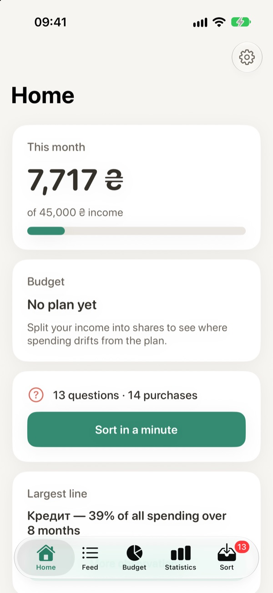
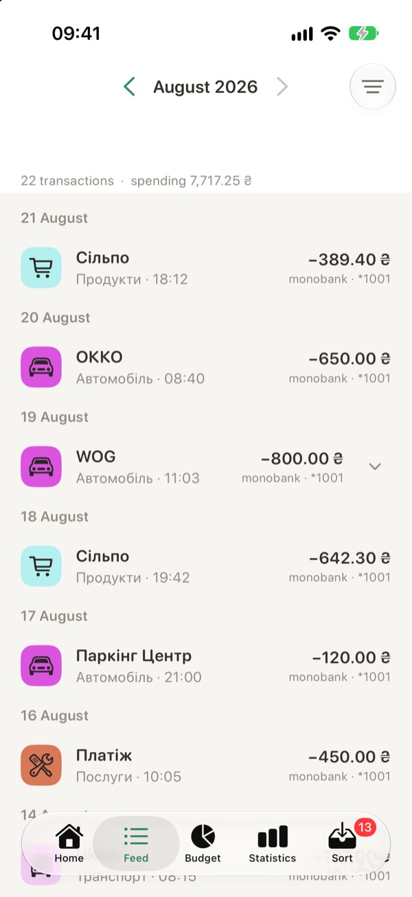
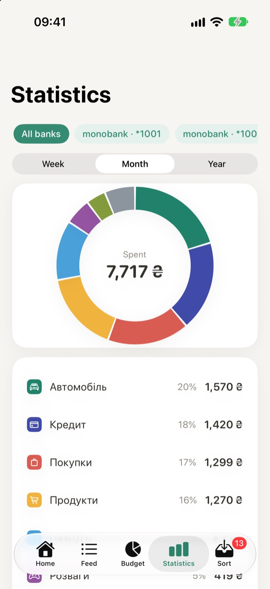
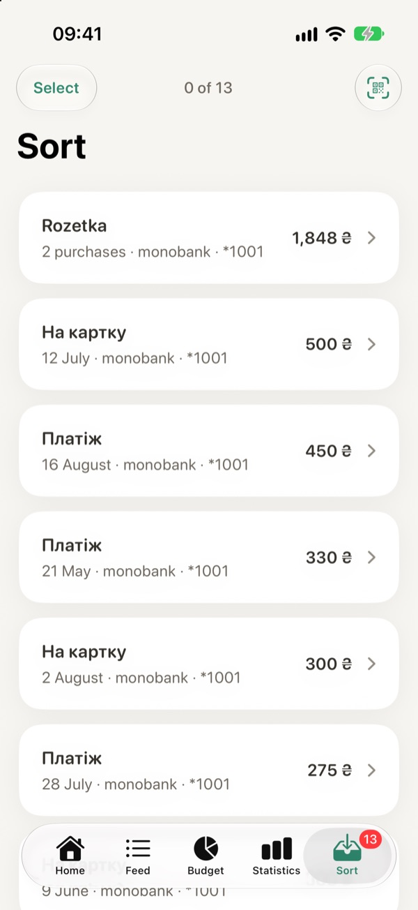
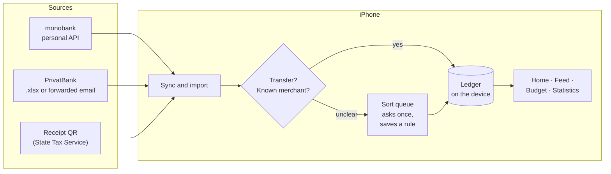

# Potik

**A personal finance app for Ukrainian banks that asks instead of guessing.** It pulls
transactions from monobank and PrivatBank, reads fiscal receipts by their QR code, and
sorts spending into categories. When a purchase could mean two things (the same shop
sells a kettle and a gift), it asks you once instead of filing it under the wrong
heading.


<table>
  <tr>
    <td></td>
    <td></td>
    <td></td>
    <td></td>
  </tr>
  <tr>
    <td align="center">Home</td>
    <td align="center">Feed</td>
    <td align="center">Statistics</td>
    <td align="center">Sort</td>
  </tr>
</table>

*Screenshots use the built-in demo ledger. Every merchant, amount and card in it is invented.*

---

## Why it exists

Bank apps categorize by the merchant's MCC code, and that goes wrong in predictable ways:

1. **One shop, many reasons.** A marketplace purchase can be groceries, a gift or a repair
   part. Potik never guesses a category from an MCC or from raw text. An ambiguous
   purchase goes to the **Sort** queue, and your answer becomes a rule for next time.
2. **Moving money is not spending.** A top-up from your own card, a transfer to the credit
   card, or an account migration all look like outflow in a statement. Potik recognizes
   them as transfers and keeps them out of every spending total.
3. **One receipt, many things.** Scan the QR code on a Ukrainian fiscal receipt and the
   line items come from the State Tax Service, so Statistics can show what one supermarket
   trip actually bought: food, household goods, pet supplies.

## Features

### Banks
- **monobank:** connects with a personal API token. Statements sync in the background,
  within the API's limits (31-day windows, paced requests).
- **PrivatBank:** import the `.xlsx` statement the bank exports (read by a small built-in
  unzip and XML reader, with no third-party code), or forward its notification emails to
  an inbound address.
- Each card can be included or left out, and disconnecting a bank keeps its history.

### Categories that learn
- A category you pick for a merchant becomes a rule for its next purchases.
- **Sort** shows each unclear purchase with suggested categories, and supports skip, undo
  and bulk select.
- Categories can be renamed, merged and deleted, and each one gets its own icon and colour.

### Receipts
- QR scanner for fiscal receipts. The receipt is matched to its card transaction, and its
  lines split the purchase by product group. Anything the receipt doesn't itemise stays
  visible as its own line, so the total always adds up.
- Product groups are guessed from the line text, and fuel grades are recognized.

### Budget and statistics
- **Budget:** split income into shares. The income base is an average over 1 to 12
  complete months, or a fixed sum, and lines that drift from the plan are flagged on Home.
- **Statistics:** week, month and year scopes, a donut by category with drill-through,
  and a filter for a single card.
- **Feed:** month navigation, search, filters and transaction detail.

### Privacy and safety
- The ledger lives on the phone, as JSON in Application Support. There is no account to
  sign up for; the only server involved is the optional inbound mailbox for PrivatBank
  emails.
- PIN with a salted SHA-256 in the Keychain and an escalating lockout, plus Face ID. The
  lock is its own window above every sheet and dialog, so backgrounding the app never
  leaves money on screen.
- Every date is a Kyiv date, so monthly totals match the bank's statement wherever the
  phone is.
- The UI is in Ukrainian and English.

## How it works



The categorizer was first built in Python (`app/`) against real statements. The iOS app
reimplements the parts it needs, and `scripts/build_ios_test_fixtures.py` turns the
Python side's answers into Swift test fixtures, so the two implementations can't drift
apart silently. The rules themselves grew out of
[monitor-finance-bot](https://github.com/GoodGlor/monitor-finance-bot), an earlier
Gmail → Google Sheets version of the same idea.

## Tech stack

| Layer | Tools |
|---|---|
| **iOS app** | Swift, SwiftUI, Swift Concurrency, Keychain, LocalAuthentication, VisionKit (QR), BackgroundTasks. No third-party packages |
| **Backend** | Python 3.14, FastAPI, httpx, Pydantic v2, SQLite |
| **AI (optional)** | OpenRouter LLM for category suggestions. Off by default; it only ever sees scrubbed merchant text |
| **Quality** | XCTest + XCUITest, pytest, generated cross-language fixtures, source checks (allowed hosts, localization, launch flags) |

## By the numbers

| | |
|---|---|
| Swift in the app | ~23,000 lines |
| iOS unit tests | 1,242 |
| iOS UI tests | 173 |
| Python tests | 279 |
| Third-party iOS dependencies | 0 |

## Quick start

### iOS

Open `ios/MonitorFinance.xcodeproj` in Xcode, pick an iPhone simulator and press Run.
A Debug build loads the demo ledger. To skip onboarding and land on the tabs:

```bash
xcrun simctl launch booted ua.monitorfinance.app \
  -resetState -stage unlocked -noBiometrics -stubMonobank -lang en
```

[`ios/README.md`](ios/README.md) is the developer guide: every launch argument, how the
lock window works, and what to know before adding a UI test.

### Backend

**You need:** [uv](https://docs.astral.sh/uv/) (it installs Python 3.14 if needed).

```bash
uv sync
export MF_MONOBANK_TOKEN=...                       # personal token from api.monobank.ua
export MF_LLM_ENABLED=true MF_OPENROUTER_KEY=...   # optional LLM suggestions
uv run uvicorn app.main:app --reload
```

| Endpoint | What it does |
|---|---|
| `GET /accounts` | The token's monobank accounts |
| `GET /preview/{account_id}` | Recent transactions, categorized, with the layer that decided each one |
| `POST /rules/confirm` | Save an answer from the review queue as a rule |
| `POST /suggest` | Ask the LLM for category suggestions (when enabled) |

## Project structure

```
ios/
  MonitorFinance/          SwiftUI app: Sync, Import, Receipts, Budget, Stats, Security, …
  MonitorFinanceTests/     unit tests, hosted in the app
  MonitorFinanceUITests/   XCUITest suite
app/
  connectors/              monobank client: splits long ranges, paces requests
  core/                    categorizer cascade, transfer types, transliteration, rule store
  llm/                     optional OpenRouter suggestions
scripts/                   generators: demo ledger, sample statement, Swift fixtures, app icon
tests/                     pytest, including checks that read the iOS sources
```

The backend's categorizer is a cascade, and every result says which layer decided it:
learned rule → note rule → seeded pattern → structural transfer → ask. "Unresolved" is a
valid answer, not a bug.

## Tests

```bash
uv run pytest -q                              # Python, no network: every response is a fixture
ios/test.sh -only-testing:MonitorFinanceTests # iOS unit tests, ~20 s after the build
ios/test.sh                                   # everything, including the UI suite
```

The UI suite is written for the iPhone 17 Pro simulator that `ios/test.sh` names. On other
simulators, a few tests that look for the search field or tap the Files sheet by position
can fail. Two Python tests compare against a private bank export and are skipped without it.

## License

© 2026 Artem Levkovich. All rights reserved. The source is published as a portfolio piece.
If you'd like to use it, get in touch.
